# Análise Exploratória de Dados — EduGuard-IA (Fase 02)

> Data: 2026-11-05 · Branch `feat/data-exploration`
> Reprodução: `python -m src.analysis.run_phase02` (resultados em
> `research/inspection/phase02_*.json`, gráficos em `research/figures/`) e os notebooks
> `notebooks/01_oulad_eda.ipynb` e `notebooks/02_uci_eda.ipynb`.
>
> **Nenhum modelo foi treinado.** As associações abaixo são descritivas e **não
> implicam causalidade**. A "força de separação" usada aqui é |AUC − 0,5| × 2 de uma
> única variável (estatística de Mann-Whitney), de 0 (nenhuma) a 1 (separação perfeita).

---

## Parte A — OULAD (Open University Learning Analytics Dataset)

### A.1 Estrutura e granularidade

| Tabela | Linhas | Colunas | Granularidade (chave verificada como única) | Ausentes |
|---|---|---|---|---|
| courses | 22 | 3 | módulo × apresentação | 0 |
| assessments | 206 | 6 | avaliação (`id_assessment`) | 11 (`date` de provas) |
| vle | 6.364 | 6 | material do AVA (`id_site`) | 10.486 (`week_from`/`week_to`, 82%) |
| studentInfo | 32.593 | 12 | estudante × módulo × apresentação | 1.111 (`imd_band`) |
| studentRegistration | 32.593 | 5 | estudante × módulo × apresentação | 45 (`date_registration`) + 22.521 (`date_unregistration` = não cancelou) |
| studentAssessment | 173.912 | 5 | estudante × avaliação | 173 (`score`) |
| studentVle | 10.655.280 | 6 | estudante × material × dia — **não único** | 0 |

**Relacionamentos** (todas as chaves estrangeiras verificadas: **0 órfãos**):

```
courses (module, presentation)
 ├── assessments ──< studentAssessment >── studentInfo
 ├── vle ──────────< studentVle ─────────> studentInfo
 └── studentInfo ── 1:1 ── studentRegistration
```

- `studentAssessment` não tem módulo/apresentação: obtém-se via `assessments`.
- **28.785 estudantes distintos**, dos quais **3.538** aparecem em mais de uma
  apresentação (máx. 5) → risco de o mesmo indivíduo cair em treino e teste.
- Cardinalidades: 7 módulos, 4 apresentações (2013B, 2013J, 2014B, 2014J), 13 regiões,
  5 níveis de escolaridade, 10 faixas de IMD, 3 faixas etárias, 20 tipos de material.

### A.2 Qualidade dos dados

| Achado | Quantidade | Tratamento proposto |
|---|---|---|
| Missing codificado como `"?"` | — | `na_values="?"` (em `src/data/loaders.py`) |
| Linhas **totalmente** duplicadas em `studentVle` | 787.170 (7,4%) | Ambíguo: podem ser sessões distintas com a mesma contagem. **Não deduplicar sem decisão** (pendente) |
| `studentVle` com chave (estudante, material, dia) repetida | 2.195.960 | Somar `sum_click` por chave |
| `sum_click` extremo | p99 = 34, máx = 6.977 | Avaliar winsorização na Fase 03 |
| `Withdrawn` sem `date_unregistration` | 93 | Não podem ser posicionados no tempo |
| Não-`Withdrawn` com `date_unregistration` | 9 | Inconsistência de rótulo |
| `date_registration` ausente | 45 (86,7% Withdrawn) | Ausência possivelmente causada pelo próprio cancelamento → não usar como indicador |
| Entregas após o fim da apresentação | 85 (nenhuma `is_banked`) | Investigar; irrelevantes para cortes precoces |
| Datas de prova ausentes | 11 | Provas não entram nos cortes precoces |

### A.3 Resultados acadêmicos

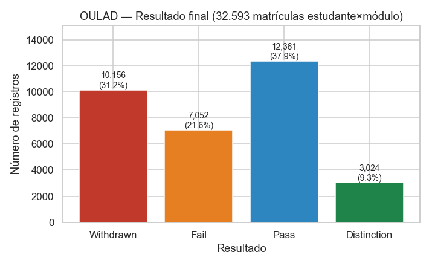

| final_result | n | % |
|---|---|---|
| Pass | 12.361 | 37,9% |
| **Withdrawn** | **10.156** | **31,2%** |
| Fail | 7.052 | 21,6% |
| Distinction | 3.024 | 9,3% |

- Forte variação por módulo: Withdrawn de **11,5% (GGG)** a **44,5% (CCC)**; por
  apresentação, de 26,8% (2013J) a 34,0% (2014J). → O módulo é um forte fator de
  contexto; a validação deve respeitar módulo/apresentação.

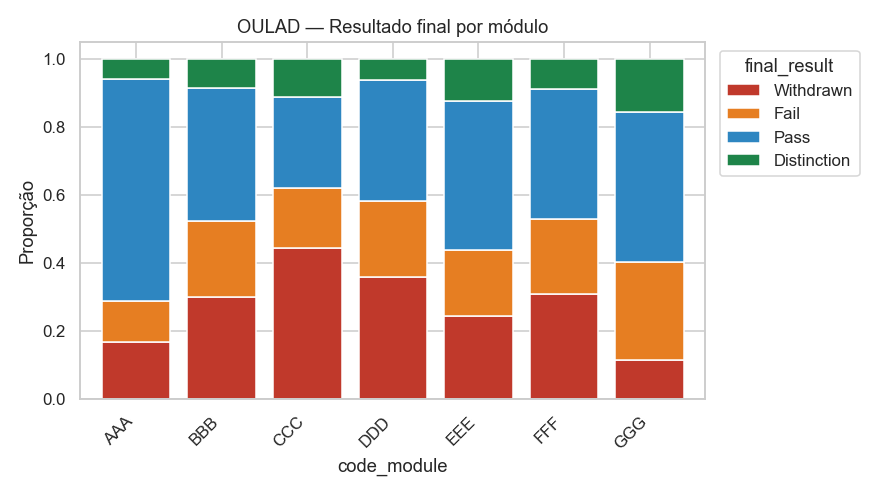

**Características de ingresso × taxa de Withdrawn** (taxa geral 31,2%):

| Variável | Maior taxa | Menor taxa | Cramér's V (4 classes) |
|---|---|---|---|
| studied_credits | >120 créditos: **51,3%** | ≤60: 25,4% | 0,105 |
| highest_education | No Formal quals: 42,9% | Post Graduate: 23,6% | 0,102 |
| imd_band | 0–10% (mais privação): 37,2% | 90–100%: 25,9% | 0,094 |
| disability | Sim: 39,4% | Não: 30,3% | 0,065 |
| num_of_prev_attempts | 2: 36,6% | 0: 30,6% | 0,072 |
| data de matrícula | ≤ −90 dias: 38,2% | após o início: 20,9% | 0,071 |
| age_band | 0–35: 32,2% | 55+: 25,0% | 0,058 |
| gender | M: 31,7% | F: 30,5% | 0,023 |

Todas as associações demográficas são **fracas** (V ≤ 0,12). Indicam vulnerabilidade
(sobrecarga de créditos, menor escolaridade prévia, maior privação), mas não bastam
sozinhas para um alerta individual.

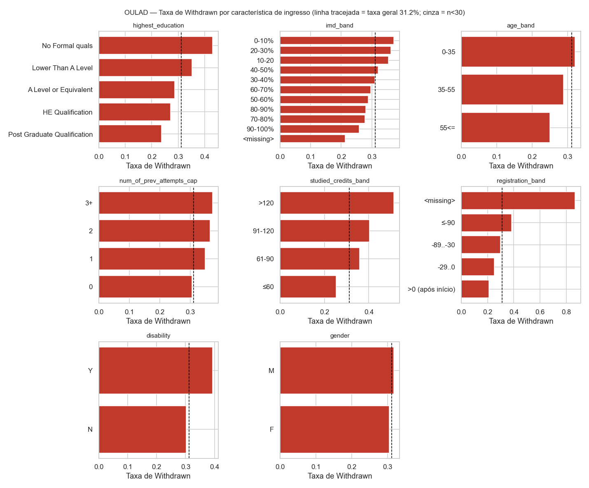

**Desempenho:** na 1ª avaliação não-final (vence entre os dias 12 e 61; mediana 21,5),
entre quem ainda estava matriculado no prazo:

| | Withdrawn | Fail | Pass | Distinction |
|---|---|---|---|---|
| Entregou | 77,4% | 79,1% | 99,0% | 99,8% |
| Nota mediana | 70 | 70 | 78 | 88 |

→ **Não entregar a primeira avaliação** é o sinal acadêmico precoce mais claro.

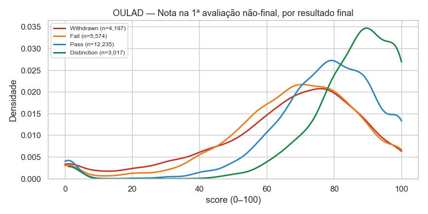

**Qualidade do rótulo — "Fail silencioso":** 41,7% dos estudantes `Fail` tiveram o
último acesso ao AVA **antes da metade** do módulo (Pass: 0,04%), e 67,6% dos `Fail`
nos módulos com registro de prova (CCC, DDD) não têm prova registrada. Uma parte
relevante de `Fail` é **abandono sem cancelamento formal** — o que afeta a definição
do rótulo binário (ver TEMPORAL_FEASIBILITY.md §5).

### A.4 Engajamento digital

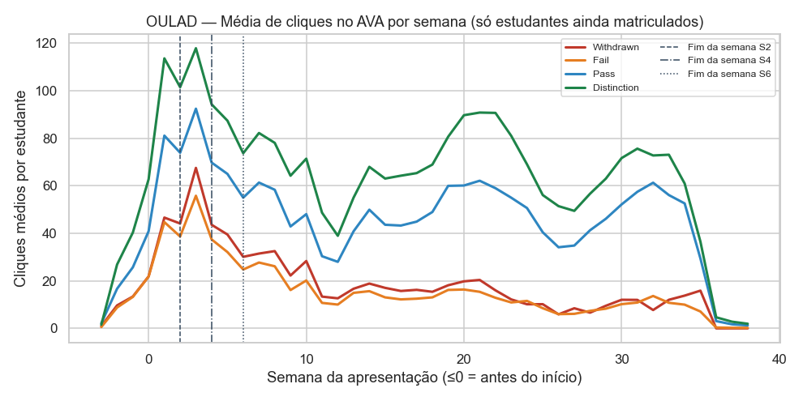

Média de cliques por semana (só estudantes ainda matriculados naquela semana):

| Semana | Withdrawn | Fail | Pass | Distinction |
|---|---|---|---|---|
| 1 | 46,6 | 44,7 | 81,1 | 113,6 |
| 2 | 44,1 | 38,7 | 73,9 | 101,5 |
| 4 | 43,6 | 37,4 | 69,7 | 94,3 |
| 6 | 30,1 | 24,8 | 55,0 | 73,7 |

- **Já na semana 1**, Withdrawn (−43%) e Fail (−45%) clicam bem menos que Pass.
- Withdrawn e Fail têm trajetórias quase idênticas nas primeiras semanas → reforça a
  hipótese do "Fail silencioso".

**Desengajamento progressivo** (4.010 estudantes que cancelaram no dia ≥ 56):

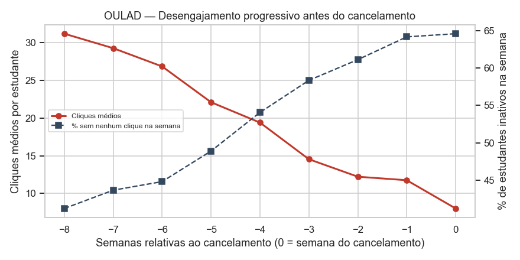

| Semanas antes do cancelamento | −8 | −6 | −4 | −2 | 0 |
|---|---|---|---|---|---|
| Cliques médios | 31,2 | 26,8 | 19,4 | 12,2 | 8,0 |
| % inativos na semana | 41,2% | 44,8% | 54,1% | 61,1% | 64,6% |

A queda de engajamento é gradual e começa semanas antes do cancelamento formal:
**recência e tendência** de acesso são candidatas fortes.

**Materiais acessados** (cliques até a semana 4): diferenças pequenas de composição —
fórum (`forumng`) 22,8% dos cliques em Withdrawn × 26,6% em Pass; `quiz` 15,5% × 12,6%.
O **volume** discrimina mais que o tipo.

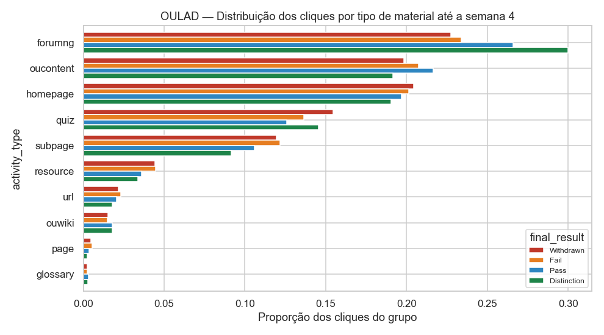

---

## Parte B — UCI 697 (Predict Students' Dropout and Academic Success)

### B.1 Estrutura e qualidade

- 4.424 estudantes × 37 colunas (36 atributos + `Target`); 0 ausentes; 0 duplicatas.
- Consistência lógica: nenhuma aprovação > inscrição; nenhuma média > 0 sem aprovação.
- Redundâncias: `Nacionality` ~ `International` (ρ = 1,0); inscritas 1º ~ 2º semestre
  (ρ = 0,96); creditadas 1º ~ 2º (0,91); aprovadas 1º ~ 2º (0,89).
- Variáveis nominais codificadas como inteiros (curso, modo de candidatura, ocupações):
  a ordem dos códigos não tem significado → avaliadas com Cramér's V, nunca como número.

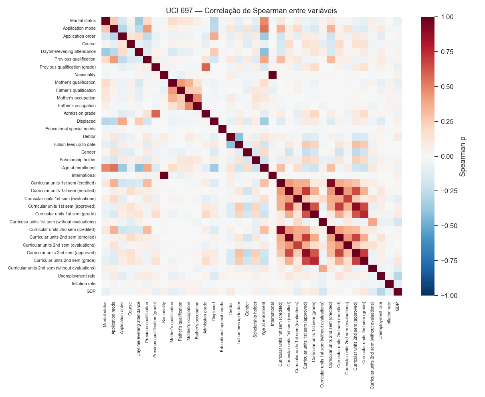

### B.2 Classes

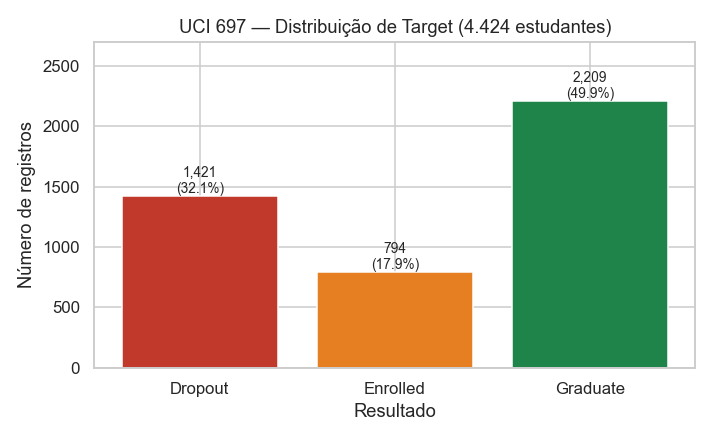

| Target | n | % |
|---|---|---|
| Graduate | 2.209 | 49,9% |
| Dropout | 1.421 | 32,1% |
| Enrolled | 794 | 17,9% |

### B.3 Diferenças entre classes

| Indicador | Dropout | Enrolled | Graduate | Disponível em |
|---|---|---|---|---|
| Idade no ingresso (mediana) | 23 | 20 | 19 | ingresso |
| Nota de admissão (mediana) | 123,6 | 124,1 | 127,4 | ingresso |
| Gênero masculino | 49,3% | 38,7% | 24,8% | ingresso |
| Bolsista | 9,4% | 16,4% | 37,8% | **data incerta** |
| Mensalidades em dia | 67,8% | 94,7% | 98,7% | **data incerta** |
| Devedor | 22,0% | 11,3% | 4,6% | **data incerta** |
| Taxa de aprovação 1º sem. (mediana) | 0,40 | 0,80 | 1,00 | fim do 1º sem. |
| Taxa de aprovação 2º sem. (mediana) | 0,17 | 0,71 | 1,00 | fim do 2º sem. |

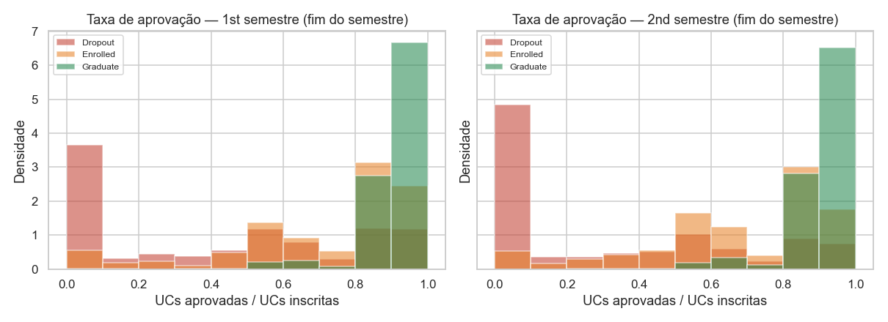

**`Enrolled` é um grupo intermediário**: desempenho bem melhor que Dropout, mas
inferior a Graduate. São estudantes atrasados cujo desfecho final é **desconhecido**.

### B.4 Associações — e por que a mais forte não serve

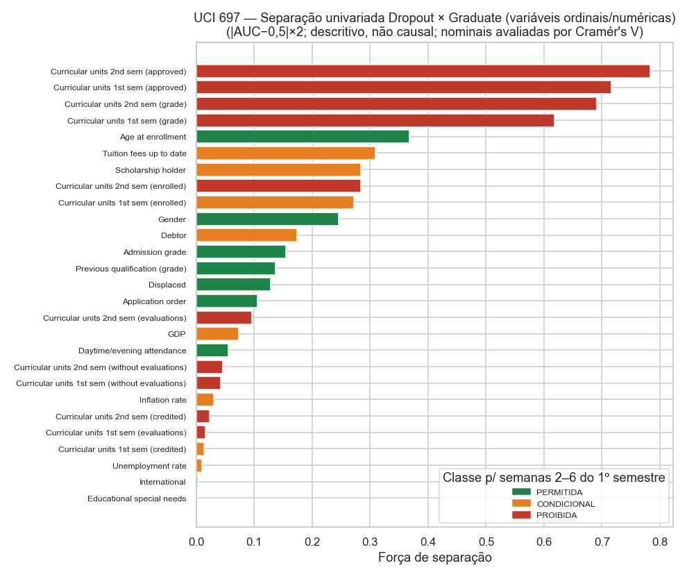

| Variável | Força de separação (Dropout × Graduate) | Classe nas semanas 2–6 do 1º sem. |
|---|---|---|
| UCs aprovadas 2º sem. | 0,784 | PROIBIDA |
| UCs aprovadas 1º sem. | 0,717 | PROIBIDA |
| Média 2º sem. | 0,691 | PROIBIDA |
| Média 1º sem. | 0,618 | PROIBIDA |
| **Idade no ingresso** | **0,368** | PERMITIDA (melhor permitida) |
| Mensalidades em dia | 0,308 | CONDICIONAL |
| Bolsista | 0,284 | CONDICIONAL |
| Gênero | 0,245 | PERMITIDA |
| Nota de admissão | 0,155 | PERMITIDA |

Nominais (Cramér's V, 3 classes): Curso 0,251; Modo de candidatura 0,230;
ocupação da mãe 0,182 / do pai 0,173.

As quatro variáveis mais associadas ao abandono são **resultados de fim de
semestre** — inadequadas para previsão nas primeiras semanas.

### B.5 Coortes

As 10 combinações (desemprego, inflação, PIB) — provável ano de ingresso — têm
Dropout entre 24,0% e 38,4% e Enrolled entre 12,7% e 20,9%. Como o ano real não é
documentado, não é possível confirmar se coortes recentes têm mais `Enrolled`
(sinal de censura).

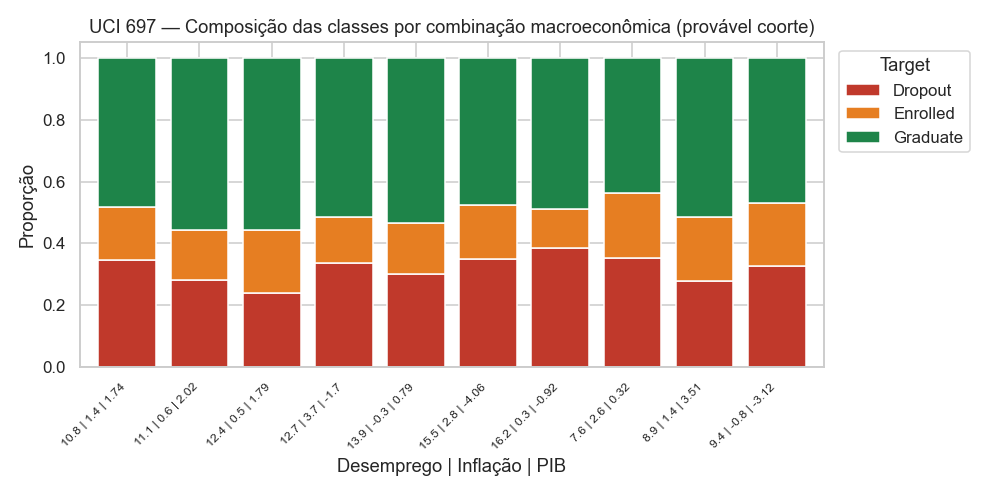

---

## Limitações dos dados

1. **OULAD:** ensino a distância britânico; unidade = módulo, não curso; sem frequência
   presencial; sem data de divulgação de notas; 7,4% de linhas duplicadas no AVA;
   apenas 4 apresentações (2013–2014).
2. **UCI:** sem datas de evento (nem de abandono); sem frequência ou engajamento; sem ano
   de ingresso explícito; rótulo `Enrolled` censurado; variáveis financeiras sem data.
3. Ambos: instituições estrangeiras; transferência para o contexto brasileiro **não é
   garantida** e precisará de validação com dados nacionais (ex.: UFRN).
