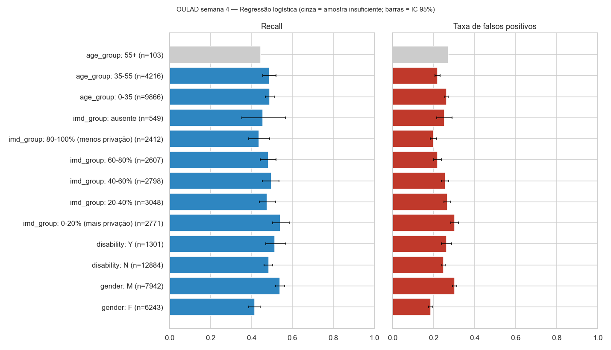
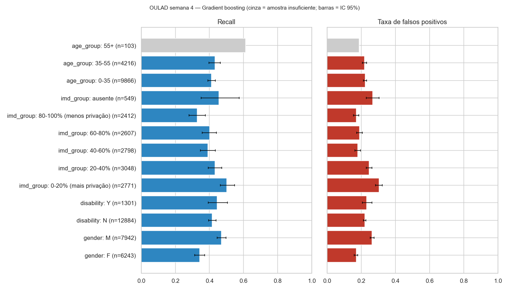

# Auditoria de Equidade — Fase 04

> Semana 4, target principal, teste 2014 sem recorrentes (14.185 registros). Thresholds de alerta
> definidos na partição de calibração (RL 0,234; GB 0,227). Código: `src/modeling/fairness.py`.
> Gênero e deficiência **não são preditores** (decisão Q16): foram usados apenas para
> segmentar os resultados, depois das previsões. Nunca entraram na seleção de modelos, nos
> hiperparâmetros, nos thresholds, na calibração ou na imputação.
> IC 95% por bootstrap de estudantes (300 reamostragens). Grupos com menos de 100 registros ou
> menos de 20 positivos são marcados como amostra insuficiente.
>
> **Diferenças observadas não comprovam discriminação.** Elas indicam onde investigar.

## 1. Regressão logística (modelo de referência)

| Grupo | Registros (estudantes) | Cancelaram | Observado | Previsto médio | Recall [IC] | Precision | FNR | FPR [IC] | Brier |
|---|---|---|---|---|---|---|---|---|---|
| **Gênero F** | 6.243 (6.038) | 1.032 | 16,5% | 17,7% | 0,415 [0,386–0,443] | 0,308 | 0,585 | 0,185 [0,174–0,195] | 0,131 |
| **Gênero M** | 7.942 (7.040) | 1.534 | 19,3% | 21,3% | 0,538 [0,517–0,562] | 0,299 | 0,462 | 0,302 [0,292–0,313] | 0,148 |
| **Deficiência N** | 12.884 (11.883) | 2.235 | 17,3% | 19,6% | 0,485 [0,462–0,503] | 0,291 | 0,515 | 0,248 [0,240–0,255] | 0,136 |
| **Deficiência Y** | 1.301 (1.195) | 331 | **25,4%** | **20,4%** | 0,514 [0,469–0,567] | 0,400 | 0,486 | 0,263 [0,237–0,288] | 0,178 |
| IMD 0–20% (mais privação) | 2.771 (2.566) | 542 | 19,6% | 21,9% | 0,541 [0,503–0,585] | 0,303 | 0,459 | 0,302 [0,283–0,322] | 0,150 |
| IMD 20–40% | 3.048 | 604 | 19,8% | 20,6% | 0,475 | 0,306 | 0,525 | 0,266 | 0,151 |
| IMD 40–60% | 2.798 | 513 | 18,3% | 19,8% | 0,497 | 0,304 | 0,503 | 0,255 | 0,141 |
| IMD 60–80% | 2.607 | 454 | 17,4% | 18,5% | 0,482 | 0,318 | 0,518 | 0,218 | 0,135 |
| IMD 80–100% (menos privação) | 2.412 (2.204) | 374 | 15,5% | 17,5% | 0,436 [0,387–0,489] | 0,287 | 0,564 | 0,199 [0,184–0,215] | 0,124 |
| IMD ausente | 549 | 79 | 14,4% | 18,9% | 0,456 | 0,234 | 0,544 | 0,251 | 0,122 |
| Idade 0–35 | 9.866 | 1.806 | 18,3% | 20,2% | 0,489 | 0,295 | 0,511 | 0,262 | 0,142 |
| Idade 35–55 | 4.216 | 742 | 17,6% | 18,7% | 0,487 | 0,321 | 0,513 | 0,219 | 0,136 |
| Idade 55+ ⚠️ | 103 (92) | 18 | 17,5% | 18,9% | 0,444 | 0,258 | 0,556 | 0,271 | 0,138 |

⚠️ Idade 55+: amostra insuficiente (18 cancelamentos). Não tirar conclusões.

## 2. Gradient boosting (resumo)

| Grupo | Recall | FPR | Previsto × observado |
|---|---|---|---|
| F / M | 0,342 / 0,470 | 0,170 / 0,263 | 15,8% × 16,5% / 19,0% × 19,3% |
| Deficiência N / Y | 0,415 / 0,444 | 0,220 / 0,232 | 17,6% × 17,3% / **17,8% × 25,4%** |
| IMD mais / menos privação | 0,502 / 0,329 | 0,304 / 0,170 | 19,5% × 19,6% / 16,3% × 15,5% |

## 3. Achados

1. **Gênero:** o modelo sinaliza homens com mais frequência, com recall maior (0,54 × 0,42) e
   também mais falsos positivos (FPR 0,30 × 0,19); os ICs não se sobrepõem. A taxa observada
   também é maior entre homens (19,3% × 16,5%), mas a diferença de FPR vai além disso: mulheres
   que vão cancelar são menos detectadas, e homens que não vão cancelar recebem mais alertas.
   Gênero não é preditor, então a diferença vem de variáveis correlacionadas (módulo, região,
   padrão de engajamento).
2. **Deficiência — achado mais relevante:** estudantes com deficiência cancelam mais (25,4%), e o
   modelo **subestima** esse risco (previsto 20,4% na RL e 17,8% no GB). Recall e FPR são
   parecidos entre os grupos, mas a probabilidade exibida para esse grupo seria baixa demais
   (erro de calibração de cerca de −5 a −8 pontos percentuais). Excluir a variável (Q16) não
   elimina essa diferença. Ela deve ser tratada na próxima fase, por exemplo com auditoria de
   calibração por grupo antes de qualquer uso e sem incluir a variável como preditor.
3. **Privação socioeconômica (IMD):** quanto maior a privação, maior o recall e maior o FPR
   (0,30 × 0,20 entre os extremos). Mais alertas para estudantes de áreas mais pobres: parte disso
   corresponde a uma taxa observada maior (19,6% × 15,5%), parte é excesso de falsos positivos.
4. **Idade:** sem diferenças relevantes entre 0–35 e 35–55. O grupo 55+ é pequeno demais para concluir.

## 4. Com × sem `adm_imd_band` (S4)

| Modelo | PR-AUC com | PR-AUC sem | Diferença com − sem [IC 95%] |
|---|---|---|---|
| Regressão logística | 0,306 | 0,303 | +0,003 [+0,0004; +0,006] |
| Gradient boosting | 0,282 | 0,285 | −0,003 [−0,008; +0,002] |

Sem a variável, a regressão logística **iguala os falsos positivos** entre as faixas de IMD
(FPR 0,253 nos mais privados × 0,238 nos menos privados) e a calibração por faixa fica dentro de
±4 pontos percentuais (exceto IMD ausente: +7 p.p.). O ganho de PR-AUC de manter a variável é estatisticamente detectável, mas
**irrelevante na prática** (0,003).

**Recomendação (para decisão do responsável):** considerar retirar `adm_imd_band` do modelo
principal na próxima fase. O custo preditivo é desprezível, e com ela os alertas se concentram
em estudantes de áreas mais pobres, com excesso de falsos positivos, o que pode reproduzir
desigualdades socioeconômicas. A variável continuaria disponível para auditoria.

## 5. UCI (ingresso) — resumo

| Grupo (hold-out de 726) | n | Observado | Previsto | Recall | FPR |
|---|---|---|---|---|---|
| Gênero F | 438 | 29,7% | 35,4% | 0,73 | 0,34 |
| Gênero M | 288 | 53,5% | 47,5% | 0,77 | 0,44 |
| Idade ≤20 | 422 | 26,8% | 30,6% | 0,61 | 0,28 |
| Idade >25 | 174 | 66,7% | 62,2% | 0,88 | **0,81** |
| Necessidades educativas especiais Y ⚠️ | 9 | — | — | — | — |

Na UCI, a idade domina: **81%** dos estudantes com mais de 25 anos que se formaram receberiam um
alerta falso. Isso mostra o risco de modelos baseados só em ingresso, que rotulam grupos inteiros.
O grupo com necessidades especiais tem apenas 9 pessoas no teste: nenhuma conclusão é possível.

## 6. Limitações

- Uma única divisão de teste (2014); ICs refletem só a variação amostral daquele ano.
- Equidade avaliada para um threshold específico. Outro threshold mudaria recall e FPR por grupo.
- Os grupos usam as categorias disponíveis na OULAD (gênero binário, deficiência autodeclarada,
  IMD da área de residência), que são aproximações imperfeitas.
- Nenhuma técnica de mitigação foi aplicada nesta fase. As diferenças estão documentadas, não corrigidas.
