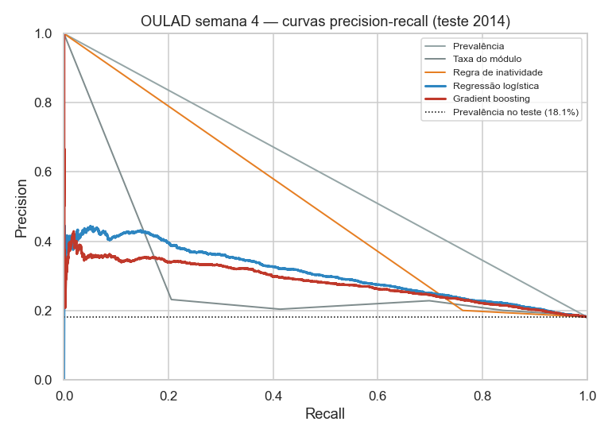
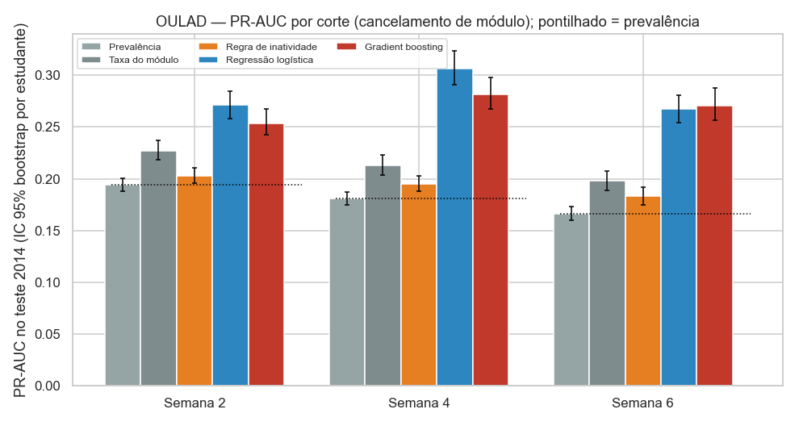
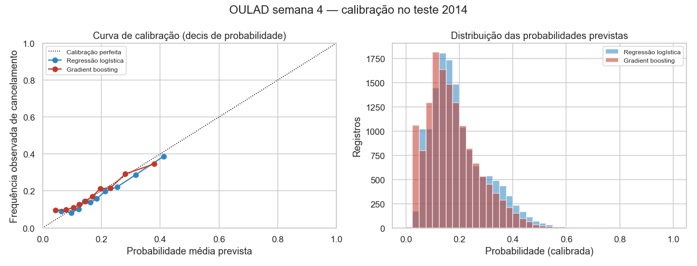
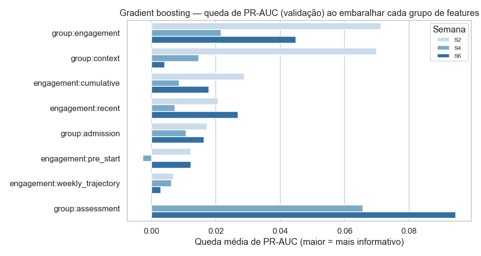
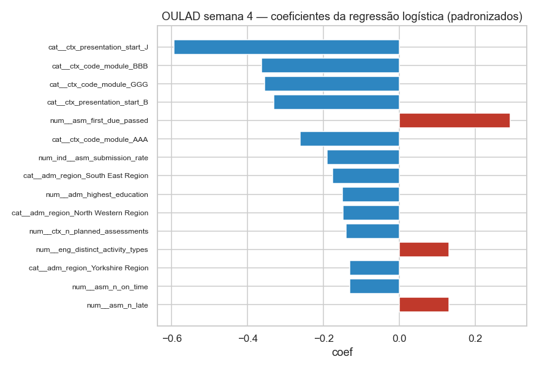
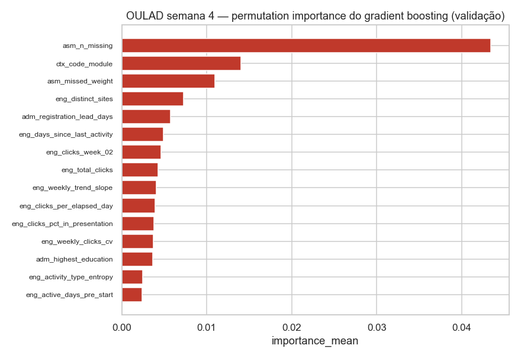

# Avaliação dos Modelos — Fase 04

> 2026-11-05 · Resultados do commit `af23584` (árvore limpa), seed 42. Reproduza com
> `python -m src.modeling.run_phase04`. Arquivos: `reports/modeling/**/results.json`,
> `reports/modeling/comparisons/*.csv`, gráficos em `reports/modeling/figures/`.
>
> **Escopo:** predição de **cancelamento de módulo** (OULAD), não de evasão institucional.
> Resultados experimentais, **não prontos para decisões institucionais automatizadas**.

## 1. Resumo executivo

- Com dados das primeiras semanas, a regressão logística **supera claramente todos os baselines**
  em todos os cortes (IC 95% da diferença sempre acima de zero). O desempenho absoluto, porém, é
  **modesto**: na semana 4, PR-AUC = 0,306 para uma prevalência de 0,181 (1,7× o acaso) e
  ROC-AUC = 0,668.
- **Semana 4 é o melhor equilíbrio**: maior ganho sobre a prevalência (1,69×). Esperar até a
  semana 6 não melhora a discriminação (ROC-AUC 0,667) e perde mais casos que já teriam ocorrido.
- **Regressão logística ≥ gradient boosting**: melhor nas semanas 2 e 4 (diferenças pequenas,
  mas com IC excluindo zero) e empatada na semana 6. Somada à interpretabilidade e à calibração
  adequada sem pós-processamento, é o **melhor equilíbrio**. Não há "vencedor" por margem grande.
- Probabilidades **razoavelmente calibradas** (ECE 0,02), com leve superestimação em 2014.
- Informação mais útil em S4/S6: **não entregar avaliações vencidas**. Em S2: contexto do módulo
  e engajamento relativo à turma.
- O target secundário (resultado adverso) é bem mais previsível (PR-AUC 0,69; prevalência 0,42).

## 2. Métricas

PR-AUC (*average precision*) é a métrica principal, por causa do desbalanceamento; ROC-AUC,
Brier, log loss, ECE (erro de calibração em decis), precision, recall e F1 no threshold de alerta
(escolhido na partição de calibração) e recall/precision entre os 10% e 20% de maior risco.
**Accuracy não é usada.** Como a prevalência muda entre cortes, a comparação entre semanas usa o
**ganho sobre a prevalência** (PR-AUC ÷ prevalência) e o ROC-AUC, não o PR-AUC bruto.

## 3. OULAD — target principal (`target_withdrawn`), teste 2014 sem recorrentes

IC 95% por bootstrap de estudantes (1.000 reamostragens).

### Semana 2 (dia 13) — n = 14.392, prevalência 19,4%

| Modelo | PR-AUC [IC 95%] | ROC-AUC | Brier | ECE | Precision / Recall (threshold) | Recall top 10% | Precision top 10% |
|---|---|---|---|---|---|---|---|
| Prevalência | 0,194 [0,188–0,201] | 0,500 | 0,157 | 0,054 | — | 6,7% | 13,0% |
| Taxa do módulo | 0,227 [0,218–0,237] | 0,578 | 0,155 | 0,046 | 0,215 / 0,844 | 13,5% | 26,2% |
| Inatividade (N = 1) | 0,203 [0,196–0,211] | 0,526 | 0,156 | 0,047 | 0,206 / 0,729 | 7,0% | 13,5% |
| **Regressão logística** | **0,271 [0,258–0,285]** | **0,629** | **0,152** | **0,014** | 0,257 / 0,650 | **15,7%** | **30,6%** |
| Gradient boosting | 0,253 [0,243–0,267] | 0,605 | 0,154 | 0,020 | 0,239 / 0,658 | 14,6% | 28,4% |

### Semana 4 (dia 27) — **principal** — n = 14.185 registros (13.078 estudantes), 2.566 cancelamentos (18,1%)

| Modelo | PR-AUC [IC 95%] | ROC-AUC | Brier | Log loss | ECE | Precision / Recall (threshold) | Recall / Precision top 10% | Recall / Precision top 20% |
|---|---|---|---|---|---|---|---|---|
| Prevalência | 0,181 [0,174–0,188] | 0,500 | 0,148 | 0,473 | 0,047 | — | 6,9% / 12,4% | 13,8% / 12,5% |
| Taxa do módulo | 0,213 [0,204–0,223] | 0,579 | 0,147 | 0,471 | 0,043 | 0,203 / 0,413 | 14,0% / 25,3% | 24,7% / 22,4% |
| Inatividade (N = 1) | 0,195 [0,188–0,203] | 0,544 | 0,147 | 0,470 | 0,046 | 0,200 / 0,763 | 6,8% / 12,3% | 17,0% / 15,4% |
| **Regressão logística** | **0,306 [0,291–0,324]** | **0,668** | **0,140** | **0,448** | 0,022 | **0,302 / 0,488** | **21,4% / 38,8%** | **37,3% / 33,7%** |
| Gradient boosting | 0,282 [0,267–0,298] | 0,651 | 0,142 | 0,455 | 0,015 | 0,295 / 0,419 | 19,1% / 34,6% | 35,3% / 31,9% |

Grupos de maior risco da regressão logística: os **10%** mais arriscados = 1.419 registros com
**550** cancelamentos (de 2.566); os **20%** = 2.837 registros com **957** cancelamentos.
Matriz de confusão no threshold 0,234: VP 1.253 · FP 2.899 · FN 1.313 · VN 8.720 (29% sinalizados).

### Semana 6 (dia 41) — n = 13.969, prevalência 16,7%

| Modelo | PR-AUC [IC 95%] | ROC-AUC | Brier | ECE | Precision / Recall | Recall top 10% | Precision top 10% |
|---|---|---|---|---|---|---|---|
| Prevalência | 0,167 [0,160–0,173] | 0,500 | 0,139 | 0,043 | — | 6,9% | 11,5% |
| Taxa do módulo | 0,198 [0,189–0,208] | 0,581 | 0,138 | 0,036 | 0,209 / 0,692 | 14,3% | 23,8% |
| Inatividade (N = 3) | 0,183 [0,175–0,192] | 0,550 | 0,138 | 0,040 | 0,167 / 1,000 | 8,4% | 14,0% |
| **Regressão logística** | **0,267 [0,254–0,281]** | **0,667** | **0,133** | 0,028 | 0,272 / 0,566 | 18,8% | 31,4% |
| **Gradient boosting** | **0,271 [0,257–0,287]** | 0,657 | 0,134 | 0,030 | 0,262 / 0,529 | 19,8% | 33,0% |

### Comparações (bootstrap pareado por estudante, PR-AUC no teste)

| Corte | Gradient boosting − Regressão logística | Regressão logística − melhor baseline (taxa do módulo) |
|---|---|---|
| S2 | −0,018 [−0,025; −0,010] → RL melhor | +0,044 [+0,035; +0,055] |
| S4 | −0,025 [−0,035; −0,015] → RL melhor | +0,094 [+0,082; +0,107] |
| S6 | +0,004 [−0,004; +0,013] → **empate** | +0,069 [+0,058; +0,081] |

## 4. Semanas 2 × 4 × 6 — custo da antecipação

| | S2 | **S4** | S6 |
|---|---|---|---|
| Cancelamentos ainda por acontecer (Fase 02) | 55,9% | 50,4% | 45,3% |
| Ganho de PR-AUC sobre a prevalência (RL) | 1,40× | **1,69×** | 1,61× |
| ROC-AUC (RL) | 0,629 | **0,668** | 0,667 |
| Precision nos 10% de maior risco (RL) | 30,6% | **38,8%** | 31,4% |

A informação de avaliações (disponível a partir de S4) traz o principal salto. De S4 para S6 não
há ganho de discriminação, e o alerta chega duas semanas mais tarde. **S4 continua sendo o corte
recomendado. S2 serve como alerta precoce de baixa precisão.**

## 5. Seleção de modelos (validação 2013)

| Corte | Regressão logística escolhida | Gradient boosting escolhido | N da regra de inatividade |
|---|---|---|---|
| S2 | L1, C = 0,03 (17 coeficientes ≠ 0) | lr 0,05; 15 folhas; min_leaf 50; 150 iterações | 1 |
| S4 | L2, C = 0,03 | lr 0,05; 15 folhas; min_leaf 50; 150 iterações | 1 |
| S6 | L1, C = 0,1 | lr 0,05; 15 folhas; min_leaf 200; 150 iterações | 3 |

Os modelos escolhidos são sempre os de maior regularização ou menor complexidade da grade, o que
indica sinal limitado e risco de sobreajuste em modelos mais flexíveis. A regra de inatividade
com N = 1 ("sem acesso no último dia") maximiza o F1 sinalizando quase todos: a recência
isolada discrimina pouco.

## 6. Calibração (S4)

| | Calibrador escolhido (Brier fora do fold, partição de calibração) | ECE teste | Média prevista × observada |
|---|---|---|---|
| Regressão logística | nenhum (Brier 0,1312; Platt 0,1309 — ganho < 0,5%) | 0,022 | 0,197 × 0,181 |
| Gradient boosting | nenhum (Brier 0,1320; Platt 0,1323) | 0,015 | 0,176 × 0,181 |

Em S2 o gradient boosting recebeu Platt e em S6 a regressão logística recebeu isotônica; nos
demais casos nenhum calibrador superou o critério.

- Decis da regressão logística no teste: prevista 0,064 → observada 0,090 (decil mais baixo);
  prevista 0,412 → observada 0,388 (decil mais alto). No conjunto, a média prevista (19,7%)
  supera a observada (18,1%), embora a prevalência do treino seja menor (17,4%): a
  superestimação vem de mudanças na distribuição das features entre 2013 e 2014, não da prevalência.
- As probabilidades raramente passam de 0,5: o modelo **não produz certezas altas**, e não
  deveria, dado o sinal disponível.
- **Balanceamento testado** (`class_weight="balanced"`, mesma configuração): PR-AUC igual
  (0,302 × 0,306), mas probabilidades sem calibração inutilizáveis (média prevista 0,49;
  ECE 0,31). No threshold 0,5: recall 0,68 / precision 0,25. Depois da recalibração Platt, fica
  equivalente ao modelo sem balanceamento. **Conclusão:** balancear não melhora a ordenação e
  piora a calibração. Mantida a distribuição natural.

## 7. Cenário secundário — estudantes recorrentes (S4, **não** é o teste principal)

1.449 registros (1.368 estudantes) de 2014 com histórico em 2013; prevalência 31,1%.

| Modelo | PR-AUC | ROC-AUC | Brier | Recall no threshold |
|---|---|---|---|---|
| Regressão logística | 0,411 | 0,625 | 0,206 | 0,80 |
| Gradient boosting | 0,373 | 0,575 | 0,217 | 0,60 |

Ganho sobre a prevalência menor (1,32×) e ROC-AUC mais baixa: o modelo discrimina **pior** neste
grupo de alto risco, em parte por subestimar a prevalência (aprendida em 17%).

## 8. Target secundário — resultado adverso (`target_adverse_outcome`)

| Corte | Prevalência | RL PR-AUC [IC] | RL ROC-AUC | GB PR-AUC [IC] | GB − RL | Melhor baseline (inatividade) |
|---|---|---|---|---|---|---|
| S2 | 42,8% | 0,650 [0,637–0,663] | 0,711 | 0,635 [0,622–0,648] | −0,015 (RL melhor) | 0,463 |
| S4 | 41,9% | 0,689 [0,678–0,702] | 0,738 | 0,691 [0,678–0,702] | +0,002 (empate) | 0,464 |
| S6 | 40,9% | 0,717 [0,705–0,728] | 0,757 | 0,702 [0,690–0,714] | −0,015 (RL melhor) | 0,452 |

Discriminação maior que no target principal (ROC-AUC 0,71–0,76), mas trata-se de **resultado
acadêmico adverso**, não de evasão. Em S4 a regressão logística ficou menos calibrada (ECE 0,064)
que o gradient boosting (0,036). Nesse target, o melhor baseline foi a regra de inatividade.

## 9. Interpretação (associações, não causas)

Queda média de PR-AUC na validação ao embaralhar cada grupo de features:

| Grupo | GB S2 | GB S4 | GB S6 | RL S4 |
|---|---|---|---|---|
| Avaliações (entregas/faltas) | — | **0,066** | **0,095** | **0,092** |
| Engajamento (todas) | **0,071** | 0,022 | 0,045 | 0,017 |
| ↳ acumulado | 0,029 | 0,009 | 0,018 | 0,003 |
| ↳ recente | 0,021 | 0,007 | 0,027 | 0,004 |
| Contexto do módulo | **0,070** | 0,015 | 0,004 | 0,016 |
| Ingresso | 0,017 | 0,011 | 0,016 | 0,015 |

- **S2:** o que mais pesa é o módulo (GGG com risco menor, DDD maior) e o engajamento **relativo
  à turma** (`eng_clicks_pct_in_presentation`), seguidos do primeiro acesso e da escolaridade prévia.
- **S4/S6:** `asm_n_missing` (avaliações vencidas não entregues) é a feature isolada mais
  importante. Peso perdido, entregas no prazo e antecedência ao prazo vêm em seguida.
- **Recente × acumulado:** semelhantes em S2–S4; em S6 o recente supera o acumulado (0,027 × 0,018).
- **Engajamento × estático:** em S2 têm peso parecido; a partir de S4 o comportamento (entregas)
  domina os dados estáticos.
- **Escolaridade prévia** tem coeficiente negativo estável (maior escolaridade, menor risco) nos três cortes.
- **Coeficientes da RL:** sinais estáveis em 30 reajustes bootstrap para quase todas as top 15. As
  instáveis estão listadas em `results.json` (ex.: `eng_distinct_activity_types`).
- `asm_first_due_passed` (o prazo da 1ª avaliação já passou) tem coeficiente positivo: é uma
  característica do **calendário do módulo**, que interage com `asm_n_missing`, e não um
  comportamento do estudante.

Gênero e deficiência não fazem parte dos modelos (decisão Q16), portanto não aparecem como fatores.

## 10. UCI 697 — experimento independente de ingresso

Hold-out estratificado com 726 estudantes (39,1% Dropout); 16 preditores de ingresso (Gender e
Educational special needs ficaram só para auditoria).

| Modelo | PR-AUC [IC 95%] | ROC-AUC | Brier | ECE | Precision / Recall | Precision top 10% | PR-AUC na validação cruzada |
|---|---|---|---|---|---|---|---|
| Prevalência | 0,391 | 0,500 | 0,238 | 0,069 | — | 27,4% | 0,391 |
| Taxa do curso | 0,580 [0,521–0,637] | 0,698 | 0,209 | 0,024 | 0,481 / 0,831 | 67,1% | 0,569 |
| Regressão logística | 0,676 [0,619–0,734] | 0,761 | 0,191 | 0,039 | 0,565 / 0,754 | 78,1% | 0,676 |
| Gradient boosting | 0,705 [0,649–0,757] | 0,767 | 0,187 | 0,049 | 0,535 / 0,761 | 84,9% | 0,680 |

- GB − RL = +0,027 [−0,000; +0,055]: **diferença não convincente** (o IC encosta em zero; a validação
  cruzada mostra os dois praticamente iguais: 0,680 × 0,676).
- RL − taxa do curso = +0,096 [+0,052; +0,143].
- Por coorte (`cohort_proxy`, não temporal), a PR-AUC da RL varia de **0,51 a 0,78**: o desempenho
  depende bastante da coorte.
- **Não comparável à OULAD:** outro país, outro problema (abandono do curso inteiro, medido no
  fim do prazo normal), outro momento (ingresso) e exclusão de `Enrolled`, que torna a avaliação
  otimista.

## 11. Limitações (obrigatórias)

1. A OULAD prevê **cancelamento de módulo**, não evasão institucional.
2. A OULAD não representa o ensino presencial brasileiro.
3. A UCI é outro contexto e outro problema de previsão.
4. A exclusão de `Enrolled` na UCI torna a avaliação otimista.
5. As métricas **não** comprovam desempenho em instituições brasileiras.
6. Coeficientes e importâncias são associações, **não causas**.
7. Os resultados são experimentais e **não estão prontos** para decisões automatizadas.
8. As faixas de risco são preliminares e **não devem rotular estudantes reais**.
9. O teste principal exclui os recorrentes, que têm o dobro da taxa de cancelamento e nos quais o
   modelo discrimina pior.
10. Só existe um ano de teste (2014) e apenas 4 apresentações por módulo, então a estabilidade
    temporal não pode ser avaliada com mais de um período.
11. O desempenho absoluto é modesto: no threshold de alerta da S4, cerca de metade dos
    cancelamentos não é detectada e 7 em cada 10 alertas são falsos positivos.
