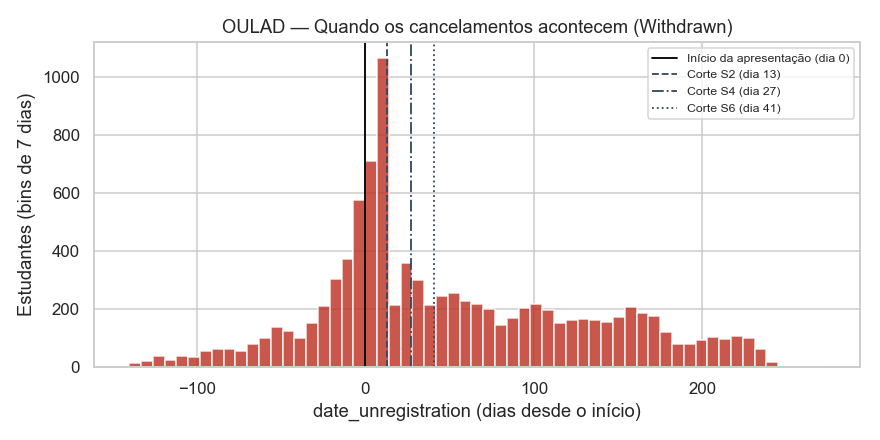
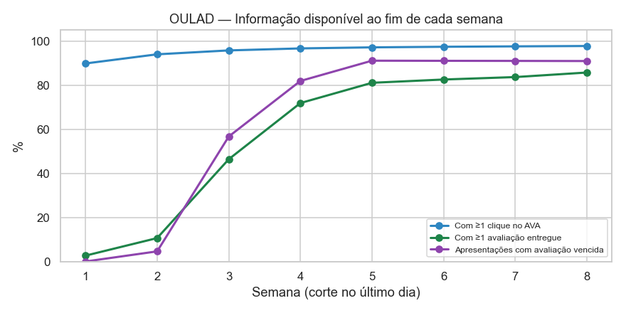
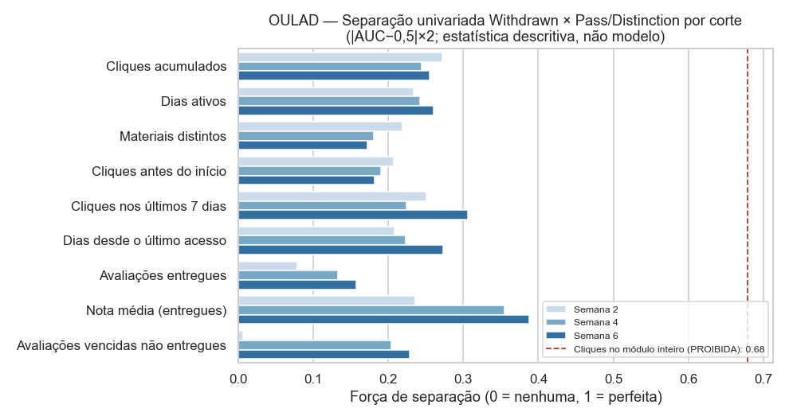
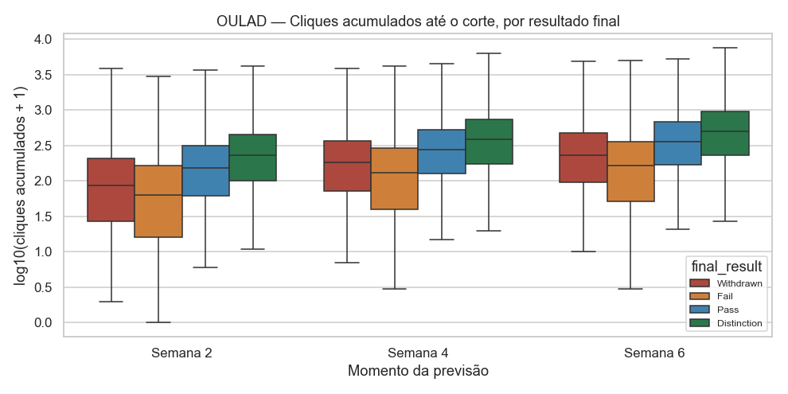

# Viabilidade Temporal — Previsão nas Semanas 2, 4 e 6

> Fase 02 · 2026-11-05. Código: `src/feature_engineering/temporal.py`.
> Notebook: `notebooks/03_temporal_feasibility_and_leakage.ipynb`.
> Nenhum modelo foi treinado. Os números são contagens e estatísticas descritivas.

## 1. Critérios adotados

| Critério | Definição |
|---|---|
| Dia 0 | Primeiro dia da apresentação do módulo (OULAD). Datas negativas = antes do início |
| Semana *k* | Dias 7(k−1) … 7k−1 (semana 1 = dias 0–6) |
| Momento da previsão | **Fim** da semana *k* ⇒ `cutoff_day = 7k − 1` → S2 = dia 13, S4 = dia 27, S6 = dia 41 |
| Eventos utilizáveis | Somente com data própria ≤ `cutoff_day` (cliques, entregas). Cliques antes do dia 0 contam |
| População do corte | Matriculado até o corte (`date_registration ≤ corte` ou desconhecida) **e** não cancelado até o corte (`date_unregistration` ausente ou > corte) |
| Notas | Consideradas conhecidas no dia da entrega (**otimista**: a OULAD não tem data de divulgação) |
| Resultados "banked" | Excluídos (semântica de data não documentada) |
| Rótulo | `final_result`, observado no fim do módulo — sempre **depois** do corte |

Esses critérios estão implementados e testados (`tests/test_phase02.py`: os agregados
não mudam quando se adicionam eventos após o corte; no dado real, nenhum `last_active_day`
supera o corte e nenhum estudante já cancelado entra na população).

## 2. OULAD — quando a evasão acontece

| Janela do cancelamento | Withdrawn | % |
|---|---|---|
| Antes do dia 0 | 2.676 | 26,3% |
| Semanas 1–2 | 1.781 | 17,5% |
| Semanas 3–4 | 575 | 5,7% |
| Semanas 5–6 | 519 | 5,1% |
| Após a semana 6 | 4.512 | 44,4% |
| Sem data | 93 | 0,9% |

**Implicação:** uma previsão "nas primeiras semanas" nunca alcançará os 26% que
cancelam antes do início, e cada semana de espera perde casos que já aconteceram.

## 3. OULAD — população e informação disponível em cada corte

| | Semana 2 (dia 13) | Semana 4 (dia 27) | Semana 6 (dia 41) |
|---|---|---|---|
| População elegível | 28.069 | 27.535 | 27.022 |
| Excluídos (já cancelaram / ainda não matriculados) | 4.524 | 5.058 | 5.571 |
| Withdrawn ainda **por acontecer** | 5.682 | 5.119 | 4.604 |
| … como % de todos os Withdrawn | **55,9%** | **50,4%** | **45,3%** |
| Taxa positiva (Withdrawn × Pass/Distinction) | 27,0% | 25,0% | 23,0% |
| Estudantes com ≥1 clique até o corte | 94,0% | 96,7% | 97,4% |
| Estudantes com ≥1 avaliação entregue | **10,6%** | **71,9%** | 82,5% |
| Apresentações com avaliação já vencida | 4,6% | 81,9% | 91,0% |

### Variáveis disponíveis em cada corte

| Grupo | Semana 2 | Semana 4 | Semana 6 |
|---|---|---|---|
| Ingresso (escolaridade, IMD, idade, deficiência, tentativas anteriores, região, gênero) | ✅ | ✅ | ✅ |
| Contexto do módulo (módulo, duração, calendário de avaliações, desenho do AVA) | ✅ | ✅ | ✅ |
| Data de matrícula | ✅ | ✅ | ✅ |
| Cliques antes do início | ✅ | ✅ | ✅ |
| Volume, dias ativos, materiais distintos, recência, tendência de cliques | ✅ (2 semanas de histórico) | ✅ (4) | ✅ (6) |
| Entrega da 1ª avaliação | ⚠️ só 4,6% das apresentações já tiveram prazo | ✅ 81,9% | ✅ 91,0% |
| Nota da 1ª avaliação | ⚠️ cobertura 11% | ✅ cobertura 75% | ✅ cobertura 87% |
| Atraso de entrega | ⚠️ raro | ✅ | ✅ |

### Ainda **não** disponíveis em nenhum dos cortes

- `final_result`, `date_unregistration` futura, nota de prova final, entregas e
  cliques posteriores ao corte, totais do módulo inteiro.
- Data de divulgação das notas (não existe na base).
- Frequência presencial (não existe: ensino a distância).

### Sinal disponível em cada corte

Força de separação univariada (Withdrawn × Pass/Distinction):

| Indicador (só dados ≤ corte) | S2 | S4 | S6 |
|---|---|---|---|
| Cliques acumulados | 0,272 | 0,244 | 0,255 |
| Dias ativos | 0,234 | 0,242 | 0,260 |
| Cliques nos últimos 7 dias | 0,251 | 0,224 | 0,306 |
| Dias desde o último acesso | 0,208 | 0,223 | 0,273 |
| Nota média (entregues) | 0,237* | 0,355 | 0,388 |
| Avaliações vencidas não entregues | 0,006 | 0,204 | 0,229 |
| **Referência PROIBIDA**: último dia ativo no módulo inteiro | — | **0,982** | — |
| **Referência PROIBIDA**: avaliações entregues no módulo inteiro | — | **0,901** | — |

\* só 11% dos estudantes têm nota na semana 2.

**Leitura:** nenhum indicador isolado é decisivo (≤ 0,39), o que é esperado num
problema real sem vazamento; a combinação de indicadores será avaliada na Fase 03.
As referências proibidas mostram **como seria fácil obter números irrealmente altos**
com agregados do período inteiro.

### Avaliação por corte

- **Semana 2:** viável para um **primeiro alerta** baseado em engajamento (94% têm
  atividade; 56% dos cancelamentos ainda estão por vir). Quase não há informação
  acadêmica.
- **Semana 4:** primeiro ponto com **informação acadêmica e comportamental juntas**
  (72% já entregaram algo; 82% das apresentações tiveram prazo). Metade dos
  cancelamentos ainda está no futuro.
- **Semana 6:** ganho marginal de sinal (+0,01 a +0,08) em troca de perder mais 5 pp
  dos cancelamentos previsíveis.

## 4. UCI 697 — limitações temporais

A UCI **não tem nenhuma data** além de "ingresso" e "fim do 1º/2º semestre", e não
informa quando o estudante abandonou.

| Momento | Variáveis disponíveis | Avaliação |
|---|---|---|
| Semanas 2–6 do **1º semestre** | Só ingresso (18 permitidas) + inscrições/créditos do 1º sem. (condicionais) + financeiras e macro (condicionais) | **Viável, mas fraco**: melhor separação univariada permitida = 0,368 (idade). Nenhum sinal comportamental |
| Semanas 2–6 do **2º semestre** | Ingresso + resultados do 1º semestre | Sinal forte (0,717), **mas** não é possível excluir quem já abandonou durante o 1º semestre (falta a data). Ex.: os 169 estudantes com 0 avaliações no 1º semestre (100% Dropout) já teriam saído e não deveriam estar na população. O desempenho estimado ficaria inflado |
| Qualquer semana | Resultados do 2º semestre | **Proibido** |

## 5. Rótulo binário — opções

### OULAD

| Opção | Definição | n | Taxa positiva | Observação |
|---|---|---|---|---|
| A | Withdrawn = 1 × Pass/Distinction = 0 (Fail excluído) | 25.541 | 39,8% | Rótulo limpo; mas em produção os "Fail" também serão pontuados |
| B | Withdrawn = 1 × todos os demais = 0 | 32.593 | 31,2% | Trata 41,7% de "Fail silenciosos" como não-evasão |
| C | Withdrawn ou Fail = 1 × Pass/Distinction = 0 | 32.593 | 52,8% | Mede "risco de não concluir com êxito" — mais alinhado à intervenção pedagógica, mas não é só evasão |

### UCI

| Opção | Definição | n | Taxa positiva | Observação |
|---|---|---|---|---|
| A | Dropout × Graduate (Enrolled excluído) | 3.630 | 39,2% | Defensável como análise de casos completos; otimista (remove o grupo intermediário) |
| B | Dropout × Graduate + Enrolled | 4.424 | 32,1% | Trata desfecho censurado como não-evasão: **viés** se parte dos Enrolled abandonar depois |
| C | Dropout + Enrolled × Graduate | 4.424 | 50,1% | Mede "não concluiu no prazo", não evasão |

**Proposta (aguardando sua decisão):** OULAD **A** como principal, com C como
sensibilidade e avaliação final sobre a população completa do corte; UCI **A** como
principal, com B como análise de sensibilidade. `Enrolled` **não** é automaticamente 0.

## 6. Recomendação de corte

**Semana 4 (dia 27) como momento principal**, com a **semana 2 como alerta precoce**
complementar e a semana 6 apenas como referência de comparação. Motivos:

1. É o primeiro corte com sinal acadêmico real (entrega e nota da 1ª avaliação) somado
   ao engajamento.
2. Ainda restam 50,4% dos cancelamentos por acontecer — há tempo para intervir.
3. A semana 6 acrescenta pouco sinal e perde mais casos.
4. A semana 2 é útil para alcançar os 17,5% que cancelam nas semanas 1–2, mas com
   sinal apenas comportamental.

A Fase 03 deve treinar e avaliar **por corte** (S2, S4, S6) para medir o custo da
antecedência, e não escolher o corte apenas pelo melhor desempenho.

Para os 26% que cancelam **antes do início**, seria preciso um modelo de "dia 0"
(matrícula + cliques prévios) — fora do escopo atual, registrado como pendência.
